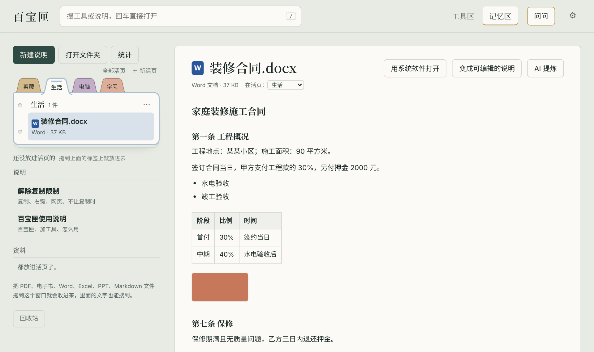
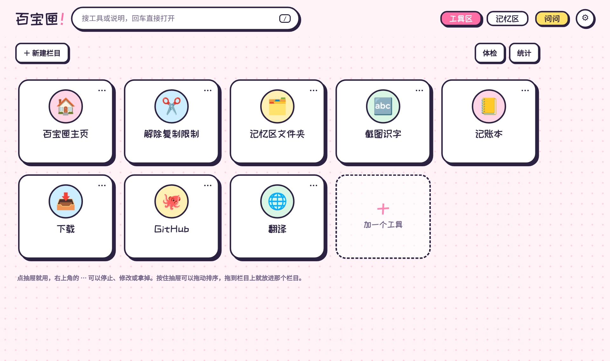

<div align="center">

# 百宝匣

**一键打开常用工具 + 一个只属于自己的说明和资料库**

所有东西都存在你自己的电脑里，不用注册，不用联网。

[下载](https://github.com/mengyiheqiao/baibaoxia/releases/latest) · [使用手册](docs/使用手册.md) · [做皮肤](皮肤示例/皮肤制作说明.md) · [English](#english)


</div>

## 它是干什么的

灵感来自《我的世界》的末影箱：一个随手打开、什么都装得下的箱子。

- **工具区**：常用的网站、文件夹、软件、本地项目，每个都是一个抽屉，点一下就打开。本地项目（比如从 GitHub 下载的小网站）会自动启动、等它准备好再打开网页。
- **记忆区**：自己写的说明、踩过的坑、收进来的 PDF、电子书、Word / Excel / PPT，全都能搜到，用彩色活页分门别类。


## 功能

**工具区**
- 网址、文件夹、程序、本地项目、书签小工具，填个表就放进柜子
- **组合技**：一个按钮按顺序做好几件事，比如先开代理，等 3 秒，再开某个项目
- **从 GitHub 收编**：贴上项目网址，自动下载、识别启动命令，以后一键检查更新
- **体检**：检查哪些工具打不开了，能修的一键修
- 栏目、拖动排序、图片图标、使用统计

**记忆区**
- Markdown 说明，粘贴截图直接插进去
- **活页**：像夹子里带彩色标签的分隔页，拖进去就分好类；可以钉住、置顶、收进档案盒，整张导出发给别人
- 拖进 PDF、EPUB 电子书、Word / Excel / PPT，在百宝匣里就能看，里面的字都能搜
- 电子书阅读器：划线、笔记、书签，能导出成读书笔记
- **网页剪藏**：装上浏览器插件，选中文字点一下就存进来
- 回收站、自动备份（可以备份到 OneDrive 之类的同步文件夹）

**其他**
- **AI 管家**：接上 DeepSeek、通义千问等 AI，她会自己翻你的资料回答并标出处；还能听吩咐做事，比如"帮我看看昨天存的资料讲了什么""打开记账本""把这些放进学习活页"；名字和性格可以自己定
- **截图识字**（Windows）：框选屏幕上的字，自动复制好
- **皮肤**：自带原皮、极简、二次元三套，也能把 `.bbskin` 皮肤文件拖进来安装
- **桌面版**：独立窗口，托盘常驻，全局快捷键，开机自启
- **小更新包**：以后升级只需把几 MB 的 `.bbupdate` 拖进窗口

<table>
<tr>
<td></td>
<td></td>
</tr>
<tr>
<td align="center">Word / Excel / PPT 直接看、直接搜</td>
<td align="center">二次元皮肤</td>
</tr>
</table>

## 下载安装

第一次使用的步骤、每个功能的用法和常见问题见 **[使用手册](docs/使用手册.md)**。

到 [Releases 页面](https://github.com/mengyiheqiao/baibaoxia/releases/latest) 下载。

### 桌面版（推荐，Windows 10 / 11）

1. 下载 `Baibaoxia-Desktop-x.x.x.zip`
2. 解压到一个你常用的地方，比如 `D:\百宝匣`（**不要**放在 `C:\Program Files` 里，否则没法保存数据和更新）
3. 双击里面的 `百宝匣.exe`

如果 Windows 提示"已保护你的电脑"，那是因为软件没有付费签名。点"更多信息"→"仍要运行"就行。

你的数据都放在 `百宝匣.exe` 旁边，整个文件夹拷走就是全部家当。

### 网页版（Windows / macOS / Linux）

1. 先装 [Node.js](https://nodejs.org)，20 或更新的版本都行
2. 下载 `Baibaoxia-Web-x.x.x.zip` 并解压
3. Windows：双击 `启动百宝匣.bat`；macOS / Linux：在文件夹里运行 `node server.js`
4. 浏览器会自动打开 http://127.0.0.1:3456

用的时候那个黑色窗口别关，关掉百宝匣就停了。

### 浏览器插件（网页剪藏）

插件在压缩包里的 `浏览器插件` 文件夹，Chrome 和 Edge 都能用：

1. 地址栏输入 `chrome://extensions`（Edge 是 `edge://extensions`）
2. 打开"开发者模式"
3. 点"加载已解压的扩展程序"，选 `浏览器插件` 文件夹

### 升级

- 已经在用 0.11.0 或更新的版本：下载 `Baibaoxia-Update-x.x.x.bbupdate`，拖进百宝匣窗口
- 更老的版本：先彻底退出百宝匣（桌面版：右键托盘图标 → 退出），再把新的完整版解压覆盖进去

两种方式都不会动你的数据。

## 隐私

- 工具、说明、资料、设置全都存在你自己的电脑上，百宝匣没有服务器，也不收集任何信息
- 百宝匣只在本机（127.0.0.1）上运行，局域网里的其他电脑访问不到
- 只有这些情况会联网：你点开网址类工具；从 GitHub 下载或更新项目；剪藏网页图片；以及你自己填了 AI 设置后用"问问"、"AI 提炼"。用 AI 时，相关内容会发给你选的那家 AI 服务

## 自己动手改

不需要编译，改完刷新页面就能看到效果。运行时没有任何第三方依赖，只用 Node.js 自带的功能。

```bash
git clone https://github.com/mengyiheqiao/baibaoxia.git
cd baibaoxia
npm start              # 网页版：http://127.0.0.1:3456

npm install            # 想跑桌面版或者打包时才需要（会下载 Electron）
npm run desktop        # 桌面版
npm run check          # 检查所有文件有没有语法错误
npm run manual         # 改了 defaults/记忆区/百宝匣使用说明.md 后，重新生成 docs/使用手册.md
npm run build          # 打包到 dist/：网页版、桌面版、小更新包
```

第一次运行时，会从 `defaults/` 拷一份默认工具和说明出来。你的数据文件（`tools.json`、`记忆区/` 等）已经写在 `.gitignore` 里，不会被提交。

| 位置 | 是什么 |
| --- | --- |
| `server.js` | 后台：本地网页服务器和所有接口 |
| `public/` | 页面：`index.html`、`app.js`、`style.css`，`skins/` 是自带皮肤 |
| `lib/` | 读 PDF / EPUB / Office、zip、联网、截图识字、更新包等 |
| `desktop/` | 桌面版（Electron）的主进程和图标 |
| `defaults/` | 第一次运行时用的默认工具和说明 |
| `浏览器插件/` | 网页剪藏插件 |
| `皮肤示例/` | 做皮肤的说明和示例 |
| `scripts/` | 打包和检查脚本 |

**发布新版本**：把 `package.json`、`server.js`（`VERSION`）和 `public/app.js`（`APP_VERSION`）里的版本号改成新的，提交并推到 main。GitHub Actions 发现是没发布过的版本，就会自动打标签，打好三个包（桌面版、网页版、小更新包），发布到 Releases 页面。

有问题或想法，欢迎提 [Issue](https://github.com/mengyiheqiao/baibaoxia/issues)。更多说明见 [docs](docs/) 文件夹。

## 开源协议

[MIT](LICENSE)：可以随便用、改、分享，商用也行，保留原作者署名就好。

用到的第三方内容，各自沿用它们原来的协议：

- [PDF.js](https://github.com/mozilla/pdf.js)（`lib/pdfjs/`）：Apache-2.0
- [站酷快乐体](https://fonts.google.com/specimen/ZCOOL+KuaiLe)（`public/skins/anime/fonts/`，二次元皮肤用）：SIL Open Font License 1.1
- 桌面版基于 [Electron](https://www.electronjs.org)：MIT

---

## English

**百宝匣 (Baibaoxia, "treasure box")** is a local-first personal toolbox and knowledge base for Windows (the web version also runs on macOS and Linux).

- **Tools**: one-click launchers for websites, folders, programs and local projects. It can start a local server, wait until it is ready, then open it. Also supports multi-step "combos", importing projects from GitHub and health checks.
- **Memory**: Markdown notes, PDFs, EPUBs and Word / Excel / PPT files, all full-text searchable and organized with colored binder tabs. Includes a web-clipper browser extension, an EPUB reader with highlights, optional AI Q&A over your own notes, skins and a desktop app built on Electron.

Everything stays on your computer, and the server listens only on 127.0.0.1. The UI is in Chinese.

Run it with `npm start` (Node.js 20+, no dependencies), or download the Windows desktop build from [Releases](https://github.com/mengyiheqiao/baibaoxia/releases/latest). MIT licensed.
