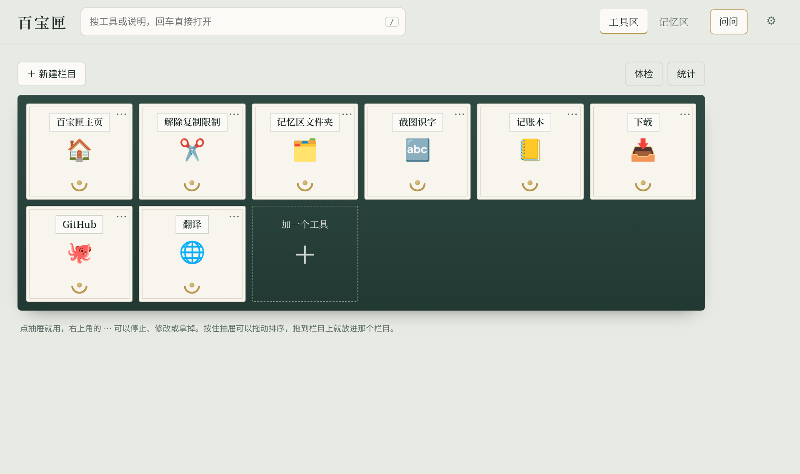
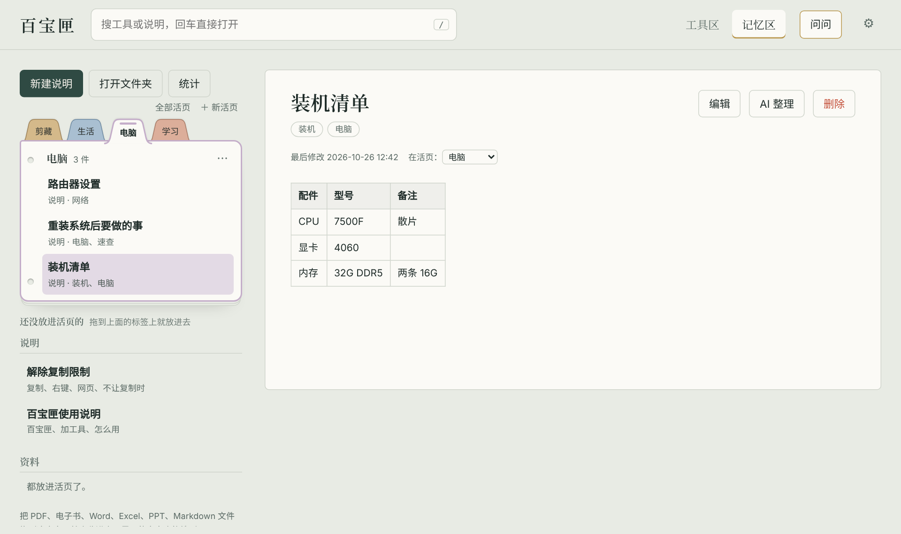

# 百宝匣使用手册

> 这份手册和软件里自带的《百宝匣使用说明》内容一样，在百宝匣的记忆区里随时能看、能搜。

## 第一次使用

1. 到 [Releases 页面](https://github.com/mengyiheqiao/baibaoxia/releases/latest) 下载 `Baibaoxia-Desktop-x.x.x.zip`
2. 解压到一个常用的地方，比如 `D:\百宝匣`（别放在 `C:\Program Files` 里）
3. 双击 `百宝匣.exe`。Windows 提示"已保护你的电脑"时，点"更多信息"→"仍要运行"
4. 工具区已经放了几个示例抽屉，点一下试试；点最后一格"加一个工具"放进你自己的
5. 点上面的"记忆区"，"新建说明"写下第一篇笔记，或者把 PDF、Word 文件直接拖进窗口





想在浏览器里用、或者用的是 macOS / Linux：装好 [Node.js](https://nodejs.org)（20 或更新）后下载网页版，运行 `启动百宝匣.bat` 或 `node server.js`，然后打开 http://127.0.0.1:3456 。

## 目录

- [速查](#速查)
- [文件夹里都是什么](#文件夹里都是什么)
- [加一个工具](#加一个工具)
- [组合技](#组合技)
- [从 GitHub 收编项目](#从-github-收编项目)
- [工具体检](#工具体检)
- [使用统计](#使用统计)
- [AI](#ai)
- [网页剪藏（浏览器插件）](#网页剪藏浏览器插件)
- [电子书的书签和笔记](#电子书的书签和笔记)
- [活页（分门别类收起来）](#活页分门别类收起来)
- [PDF 转成说明](#pdf-转成说明)
- [Word / Excel / PPT](#word--excel--ppt)
- [桌面版](#桌面版)
- [更新百宝匣](#更新百宝匣)
- [皮肤](#皮肤)
- [栏目和排序](#栏目和排序)
- [截图识字](#截图识字)
- [自动备份](#自动备份)
- [随身口袋和末影箱](#随身口袋和末影箱)
- [带走方式](#带走方式)
- [末影箱网页版](#末影箱网页版)
- [图片图标](#图片图标)
- [触屏电脑](#触屏电脑)
- [关闭和开机自启](#关闭和开机自启)
- [资料、搜索和电子书](#资料搜索和电子书)
- [回收站](#回收站)
- [高级：直接改 tools.json](#高级直接改-toolsjson)
- [写 tools.json 的几个坑](#写-toolsjson-的几个坑)
- [每一项是什么意思](#每一项是什么意思)
- [记忆区](#记忆区)
- [常见问题](#常见问题)

## 速查
- 打开：桌面版双击"百宝匣.exe"；网页版双击"启动百宝匣.bat"，浏览器会自动打开页面
- 加工具：工具区最后一格"加一个工具"，填表点"放进柜子"
- 改工具 / 拿掉工具：点抽屉右上角的 ⋯
- 栏目：工具区左上角"新建栏目"，按住抽屉拖到栏目上就放进去；栏目平时收起，点一下展开
- 关闭百宝匣、开机自启：右上角齿轮
- 搜索：按 `/` 打字，回车直接打开第一个结果。PDF、电子书里面的字也能搜到
- 电子书：在资料里点 .epub 文件就在百宝匣里打开读，←→ 键翻章
- 活页：记忆区最上面那排彩色标签。"＋ 新活页"建一张，把说明、资料拖到标签上就放进去；点标签展开，再点一下合上。Alt+1～9 直接打开第几张
- Word / Excel / PPT：直接拖进窗口，在百宝匣里就能看，里面的字也能搜到
- PDF 转成说明：资料里 PDF 那一行点"转成说明"，文字和图片变成一篇能直接修改的说明
- 回收站：记忆区左下角，删掉的东西可以恢复；删不掉时点"打开回收站文件夹"
- 组合技：加工具时选"组合技"，一个按钮按顺序做好几件事
- GitHub 收编：加工具选"本地项目"，贴 GitHub 网址点"下载"
- 体检：工具区右上角；统计：记忆区左上角
- 问问：右上角"问问"，AI 管家会自己翻你的资料回答，还能听吩咐打开工具、新建说明、放进活页（要先在设置里填 AI）；齿轮 → 管家 可以给她起名字、定性格
- 剪藏：装好"浏览器插件"后，网页上选中文字点右下角的小图标；存整篇点插件图标
- 截图识字：点"截图识字"抽屉，框选屏幕上的字，识别结果自动复制好
- 换皮肤：右上角齿轮 → 皮肤；.bbskin 皮肤文件直接拖进窗口就装好；界面乱了按 Ctrl+Alt+0 换回原皮
- 更新百宝匣：拿到 .bbupdate 小更新包，直接拖进窗口，确认一下就更新好，数据不会动
- 随身口袋：右上角"口袋"，文件拖进去、拖出来；连上末影箱（自己的 GitHub 私有仓库，加密存放）后，在学校、公司的电脑上也能拿到，还可以把记忆区和工具一起同步
- 带走方式：工具的 ⋯ 面板里填下载网址、放一个绿色版 zip；别的电脑上没有这个工具时，点一下就装好

## 详细

### 文件夹里都是什么

| 文件 | 作用 |
| --- | --- |
| 启动百宝匣.bat | 双击打开百宝匣 |
| tools.json | 工具区的所有工具 |
| 记忆区 | 所有说明（.md 文件）和资料 |
| 记忆区/资料 | 拖进来的 PDF、书 |
| 记忆区/图片 | 说明里粘贴的截图 |
| 图标 | 上传的抽屉图标图片 |
| 随身口袋 | 口袋里的文件 |
| .末影箱 | 末影箱的连接信息和同步记录，不用动 |
| settings.json、layout.json、统计.json | 设置、栏目、使用统计，不用手动改 |
| 浏览器插件 | 网页剪藏插件，装到浏览器里用 |
| server.js、public、lib | 百宝匣自己的程序，不用动 |
| defaults | 第一次运行时用的默认工具和说明，不用动 |
| 恢复前的旧文件 | 恢复备份、装更新包之前，被换掉的旧文件存在这里 |

黑色窗口别关，关掉百宝匣就停了，由它开的工具（比如本地跑的小网站）也会一起关掉。

### 加一个工具

1. 工具区点最后一格虚线的"加一个工具"
2. 选它是什么：网址 / 本地项目 / 文件夹 / 程序
3. 填位置：
    - 网址：直接粘贴网址
    - 文件夹：在文件资源管理器里打开它，点顶部地址栏，Ctrl+C 复制，粘贴进来
    - 程序：右键程序 → "复制文件地址"，粘贴进来
    - 本地项目（比如从 GitHub 下载的）：粘贴项目文件夹位置，点"自动识别"，启动命令和网址会自动填好，看一眼对不对
4. 填名字、挑个图标，点"放进柜子"

勾上"同时在记忆区建一篇说明书"，会自动生成一篇说明，记着怎么手动启动，以后踩了坑往里面补。

### 组合技

加工具时"这是什么"选**组合技**，用下面的按钮加步骤：

- **打开一个工具**：从柜子里选。本地项目会自动等它准备好再做下一步
- **等几秒**：比如等代理软件连上
- **打开网址**

步骤可以用 ↑ ↓ 调顺序。点这个抽屉，步骤会从上往下依次做；哪一步失败就停下，告诉你是哪一步、为什么。

例子"开工模式"：打开代理软件（先把它加成"程序"类型的工具）→ 等 3 秒 → 打开某个本地项目 → 打开项目的说明网页。

### 从 GitHub 收编项目

1. 加工具，选"本地项目"
2. 在"从 GitHub 收编"里贴项目网址，比如 https://github.com/作者名/项目名 ，点"下载"
3. 项目会下载到 `C:\Users\你的用户名\百宝匣项目\项目名`，启动命令、网址会自动填好
4. 看一眼没问题，点"放进柜子"

以后点这个抽屉的 ⋯ →"检查更新"，有新版本就点"更新到新版本"。更新只覆盖项目自带的文件，你自己的数据（比如 node_modules、data 文件夹）不会被删。

GitHub 在国内有时连不上，在设置 → 联网代理里填上代理软件的地址（比如 http://127.0.0.1:7890）就好。

### 工具体检

工具区右上角"体检"。

- **快速体检**：看网址能不能打开、文件和文件夹还在不在，几秒钟
- **完整体检**：本地项目会真的启动一次再关掉，久一点
- 有问题的抽屉左上角会出现一个 ! 号，鼠标放上去能看到原因；能自动修的会有修复按钮
- 百宝匣每周会自动做一次快速体检

### 使用统计

记忆区的"统计"按钮（工具区右上角也有）。主要看记忆区：

- 一共多少篇说明、多少份资料，最近 30 天新写、修改、剪藏了几篇
- **好久没看的说明**：三个月没打开过的，翻一翻，免得要用时忘了还有它
- **在读的书**：读到第几章
- 最常看的说明、最常翻的资料、常搜的词
- **搜了但没找到的词**：说明你需要写一篇了，点一下直接新建
- 最后是工具区：最常用的工具、两个月没用的工具

数据只存在本机的 统计.json 里。

### AI

先在右上角齿轮 → AI 里设置：点"DeepSeek"或"通义千问"会自动填好地址和模型，再填上你在那家网站申请的密钥，点"测试一下"。

- **AI 提炼**：记忆区资料上鼠标移过去，点"AI 提炼"，把一本手册提炼成一张速查卡，满意就"存成新说明"
- **AI 整理**：打开一篇自己写的说明，点"AI 整理"，把乱的笔记理成清楚的步骤；可以替换原文，也可以另存
- **问问（AI 管家）**：右上角"问问"。她会自己翻你的说明和资料，查完再回答，回答后面标出处，点出处能直接打开。可以直接吩咐她做事：
    - "帮我看看 10 月 20 日存的资料主要讲了什么"：按日期找出来，读完再总结
    - "我最近剪藏了哪些文章？""哪些说明好久没看了？""我在读哪些书？"
    - "把这篇 PDF 的第 3 章总结一下"
    - "打开记账本"：直接帮你打开工具
    - "把刚才说的整理成一篇说明，放进学习活页"：新建说明、放进活页（活页不存在会自动新建）
    - 她不会删除任何东西
- **自由回答**：问问面板顶上的开关。不勾时是"资料优先"，回答简短、尽量按你的资料说；勾上以后会用 AI 自己的知识完整、详细地回答，问什么都行，你的资料只当参考（用到时照样标出处）。设置 → AI 里可以设成默认打开
- **管家的名字和性格**：右上角齿轮 → 管家，起个名字，写下她的性格、说话方式、口头禅，AI 会照着演。回答时她的表情也会跟着变（思考、找到了、开心、犯困……）
- AI 要联网、按用量花钱（一般很便宜）

### 网页剪藏（浏览器插件）

**装一次**（Chrome 或 Edge 都行）：

1. 浏览器地址栏输入 `chrome://extensions`（Edge 输入 `edge://extensions`），回车
2. 打开右上角（Edge 在左下角）的"开发者模式"
3. 点"加载已解压的扩展程序"，选百宝匣文件夹里的 **浏览器插件** 文件夹
4. 浏览器右上角的拼图图标里，把"百宝匣剪藏"固定出来

**存一段**：在网页上用鼠标选中一段文字，选区右下角会冒出一个小图标，点一下就存好了。同一个网页存的几段会放进同一篇"《标题》（摘录）"里。不想在某个网站上看到这个小图标，点插件图标，勾上"在这个网站上不显示"。

**存整篇**：点插件图标 →"存整篇文章"，或者在网页上右键 →"存进百宝匣"。

**插件更新以后**：打开 `chrome://extensions`（Edge 是 `edge://extensions`），在"百宝匣剪藏"上点刷新按钮 ⟳，已经打开的网页也刷新一下。文章会存进记忆区左边单独的"剪藏"栏目（平时收起，点一下展开），图片下载到本地，最上面写着原网址。想把某篇剪藏挪到普通说明里，编辑它，把标签里的"剪藏"删掉就行。

百宝匣要开着才能剪藏。

### 电子书的书签和笔记

- 读的时候用鼠标选中一段文字，上面会弹出"划线 / 写笔记 / 复制"
- 划过的地方是黄色，点它可以改笔记或删掉
- 顶部"笔记"按钮：看这本书所有的书签和笔记，点一条就跳过去；"在这里加书签"；"导出成一篇说明"会生成《书名》读书笔记，每章有个"回到这一章"的链接

### 活页（分门别类收起来）

记忆区最上面是一叠带彩色标签的活页，像夹在夹子里的分隔页，用来把东西分门别类。没放进活页的东西照常在下面的列表里。

- **新建**：点"＋ 新活页"，起个名字。新的排在最前面，每排最多 5 张，多了会排到后面一排、错开半格露出来
- **打开 / 合上**：点一个标签，那一张就展开，下面是它装的东西（多了会翻页）；再点一下同一个标签就合上
- **放东西进去**：
  - 把下面列表里的说明或资料**拖到标签上**，松手就放进去
  - **右键**任何一件东西 →"放进活页"，挑一张；也能"移出活页"或者"新活页并放进去"
  - 看说明、看文档时，标题下面的"在活页"可以直接改
  - 某张活页**展开着**的时候，新建的说明、从电脑拖进来的文件都直接放进这一张
  - 从电脑拖文件进窗口时，屏幕上会冒出一排活页，拖到哪张上就放进哪张，也可以选"先不放"
  - 如果有一张叫"剪藏"的活页，浏览器插件剪藏的文章会自动放进去
- **改名、换颜色、换位置、删掉**：右键标签，或者点展开那张右上角的 ⋯。删掉活页不会删里面的东西，它们会回到下面的列表
- **换位置**：按住一个标签拖到另一个标签上，就排到它前面；也可以右键 →"往前挪 / 往后挪"
- **钉住**：右键标签 →"钉住"，它会一直排在最前面，标签角上有个小圆点
- **快捷键**：Alt+1 打开第 1 张，Alt+2 打开第 2 张……一直到 Alt+9
- **在活页里置顶**：活页里某件东西常用，右键它 →"在活页里置顶"，它就排在这张活页的最上面
- **活页太多**：最多显示三排，放不下的收进最后一个"+几"标签里，点它能看到全部，还能打字找
- **档案盒**：暂时不用的活页，右键 →"放进档案盒"，标签就收起来了，里面的东西不会动。点"全部活页"，在最下面的档案盒里点"拿出来"就回来了
- **导出 / 导入**：右键标签 →"导出"，整张活页（说明、资料、图片）存成一个 .bbpage 文件，可以备份或者发给别人。把 .bbpage 拖进百宝匣窗口，就导入成一张新活页，重名的会自动改名，不会覆盖你的东西
- 搜索照样能搜到所有活页里的东西

### PDF 转成说明

说明就是记忆区里的 .md 文件（Markdown），能在百宝匣里直接编辑；图片存在"记忆区/图片"里，说明里用 `` 引用。PDF 是资料，只能看、能搜，不能改。

想把一篇 PDF 文章变成能修改的说明：把 PDF 拖进来，在资料里它那一行点"转成说明"，起个名字点"开始转"。

- 文字会整理成段落；字号明显大的短行会变成小标题
- 图片会从页面上裁下来，放在原来的位置
- 扫描版的 PDF（整页都是图片、没有文字）每页存成一张图
- 分两栏、表格很多的 PDF 排版可能会乱，转好以后点"编辑"自己调一下
- 原来的 PDF 还留在资料里，不需要了可以删掉；PDF 在哪张活页里，新说明也放进同一张

### Word / Excel / PPT

- 新版的 .docx、.xlsx、.pptx 拖进来就能在百宝匣里看：Word 的标题、表格、图片都在，Excel 按表格显示，PPT 一页一页显示文字
- 里面的字能搜到，点搜索结果会跳到那个地方，搜的词标成黄色
- 文档上方的按钮："用系统软件打开"（用电脑上的 Word / WPS 打开原文件）、"变成可编辑的说明"（转成一篇说明，原文件还在）、"AI 提炼"
- 老的 .doc / .xls / .ppt 能收进来，但看不了内容也搜不到：用 Word / Excel 打开，另存为新格式再拖进来
- Windows 上，拖进来的图片会自动截图识字，图片里的字以后也能搜到

### 桌面版

- 双击"百宝匣.exe"打开，是一个独立的窗口，不需要浏览器和黑色窗口
- 点 × 是藏到右下角托盘（时间旁边），工具继续运行；点托盘图标叫回来
- 右键托盘图标：截图识字（认出来的字直接复制好）、开机自动启动、退出
- 快捷键在哪都能按：**Ctrl+Alt+B** 叫出 / 藏起百宝匣，**Ctrl+Alt+X** 老板键（马上藏起来）。设置 → 桌面版 里可以改，也可以设成点 × 直接退出
- F5 刷新，Ctrl + 加号 / 减号 放大缩小
- 数据就在"百宝匣.exe"旁边
- 更新：拿到小更新包（.bbupdate）就拖进窗口，装好会自动重新打开，见下面"更新百宝匣"；拿到的是完整版压缩包，就先从托盘彻底退出，再解压覆盖进去，数据不会被覆盖

### 更新百宝匣

作者发来的 **小更新包**（文件名像"Baibaoxia-Update-0.11.1.bbupdate"，一般只有几 MB；从 GitHub 的 Releases 页面下载）：

1. 把它拖进百宝匣窗口（或者右上角齿轮 →"更新百宝匣"→ 点"选文件"）
2. 会弹出"从 x 版更新到 y 版？"，上面写着这次改了什么，点"确定"
3. 桌面版：自动重新打开，就是新版了
4. 网页版：关掉黑色窗口（或在设置里点"关闭百宝匣"），重新双击"启动百宝匣.bat"，再按 Ctrl+F5 刷新页面

- 更新包只换百宝匣自己的程序文件，你的工具、说明、资料、皮肤、设置都不会动
- 被换掉的旧文件存在百宝匣文件夹里的"恢复前的旧文件"中，出问题可以拷回去
- 更新包坏了、版本比现在还旧、或者里面有不该有的东西，都不会安装
- 只装作者给你的更新包，来路不明的别装
- 提示"换了桌面版的内核"或者"请下载完整版"时，就要用完整版压缩包更新
- 提示"没有权限写入"：百宝匣放在了 C:\Program Files 这类系统文件夹里，把整个文件夹挪到比如 D:\百宝匣 再试

### 皮肤

右上角齿轮 → 皮肤，点一下就换，功能都不变。自带四套：

- **原皮**：深色木柜子 + 铜拉环
- **极简**：白底细线，左边是菜单，工具排成清单；电脑开了深色模式时它也会变深色
- **动漫**：粉色波点、贴纸卡片，工具区右下角有看板娘"匣宝"（窗口够宽时才出来）
- **星空**：深蓝夜空，星星绕着北极星缓缓旋转，银河和星云在呼吸，偶尔划过流星。工具是悬浮的星辰卡：正在运行的工具有一颗小卫星环绕；底下的"亮度"表示你用得多不多，最常用的会带一圈光晕。电脑开了"减少动画"时，星空会停下来

**看板娘**：有的皮肤带一个看板娘（立绘），她站在工具区右下角，会呼吸、眨眼，跟着"问问"的回答换动作（翻资料时在思考，找到了会开心地举起东西），点她就能聊天；很久不操作她会犯困。不想要可以在 设置 → 皮肤 里关掉"显示看板娘"。想给自己的皮肤加一个，看《皮肤制作说明》。

**装别人做的皮肤**：皮肤是一个 .bbskin 文件，像游戏 mod 一样，直接拖进百宝匣窗口就装好、自动换上；也可以在设置 → 皮肤里点"选文件"。装过的皮肤鼠标移上去能"删掉"。百宝匣文件夹里的"皮肤示例"有一个护眼.bbskin 可以试，旁边的《皮肤制作说明》讲了怎么自己做。

皮肤只能改样子，不能带程序，比较安全。换了皮肤以后界面乱了、找不到按钮，按 **Ctrl+Alt+0** 马上换回原皮；或者打开 http://127.0.0.1:3456/?skin=off 临时用原皮。

### 栏目和排序

- 新建：工具区左上角"＋ 新建栏目"，起个名字
- 放进栏目：按住抽屉拖到栏目上松手；或者修改工具时在"放进哪个栏目"里选
- 排序：按住抽屉拖到别的抽屉左边或右边；按住栏目的深色条可以上下拖动栏目
- 拖到收起的栏目上停一会儿，它会自动展开
- 改名、删除栏目：点栏目右边的 ⋯。删除栏目不会删里面的工具，它们会回到"未分类"

### 截图识字

1. 点"截图识字"抽屉，屏幕会变暗
2. 按住鼠标框住要识别的文字，松手
3. 几秒后右边面板里出现识别出的文字，并且已经复制好了，直接 Ctrl+V 粘贴
4. 也可以在这个面板里直接 Ctrl+V 粘贴一张图片来识别

用的是 Windows 自带的识字功能，不用联网。提示"没装识字用的语言包"时：设置 → 时间和语言 → 语言和区域 → 中文（简体）旁边的 ⋯ → 语言选项 → 安装"光学字符识别"。

### 自动备份

右上角齿轮 → 自动备份，填一个网盘会自动同步的文件夹（OneDrive、百度网盘同步空间等）。百宝匣会在里面建一个"百宝匣备份"文件夹，每 30 分钟检查一次，只复制改过的文件，不会删除备份里的任何东西。

备份的内容：记忆区、随身口袋、工具、栏目、图标、设置。

**从备份恢复**（换了电脑或误删了文件时）：右上角齿轮 → 自动备份 → 从备份恢复。

- 备份里有、这台电脑上没有的文件会直接拷回来
- 两边都有但内容不一样的，会问你要不要用备份覆盖；覆盖前会把电脑上现在的版本存到百宝匣文件夹里的"恢复前的旧文件"，不会丢
- 新电脑上要先装好百宝匣，在设置里填上同一个备份位置，再点"从备份恢复"

### 随身口袋和末影箱

右上角"口袋"打开随身口袋。把文件拖进口袋面板就放进去了；从列表里把文件拖到桌面、文件夹或聊天窗口就拿出来了（网页版要用 Chrome 或 Edge）。删掉的先进口袋的回收站。

末影箱让口袋跟着你走：口袋里的东西加密以后存进你自己的 GitHub 私有仓库，在别的电脑上打开百宝匣、连上同一个末影箱，就能拿到同样的文件。

1. 在 GitHub 上新建一个私有（Private）仓库
2. 生成一个只能用这个仓库的令牌，权限 Contents 选 Read and write
3. 口袋 → 连接末影箱，填仓库、令牌，设一个箱子密码（忘了就打不开，记牢）

在学校、网吧、朋友家这种别人的电脑上：下载桌面版解压打开，第一次会问是不是自己的电脑，选"临时用一下"。别人自己在用的百宝匣不要直接连你的末影箱，不然那台电脑原来的说明和工具会和你的合在一起。关掉百宝匣时，这台电脑上的数据、令牌、密码全部删掉。

自己电脑上：口袋 → 末影箱设置 → 生成连接码，存到手机里。到了别的电脑上，贴连接码、输密码就能连上，不用再去找令牌。

- 20 MB 以下的文件自动同步到每台电脑；更大的显示"在云端"，要用时点"拿下来"
- 两台电脑同时改了同一个文件，两份都留，另一份改名为"文件名（来自 那台电脑）"
- 一台电脑上删掉，其他电脑上也删掉（先进回收站）

连接时可以勾上"记忆区""工具和栏目""外观和 AI"，以后也能在 口袋 → 末影箱设置 里改：

- 记忆区：说明、资料、图片、活页都同步。大资料在别的电脑上显示为"☁ 在末影箱里"，点"拿下来"
- 工具和栏目：两台电脑都改了工具，按每个工具合并；同一个工具两边都改了，以后同步的那台为准
- 外观和 AI：皮肤（包括自己装的皮肤和看板娘）、AI 的接口地址、模型和密钥、管家的名字和性格。代理、备份位置这些每台电脑不一样的不同步
- 程序、文件夹这类工具在每台电脑上的位置可能不一样：在某台电脑上用"它在这台电脑的别的位置"指定的位置，只记在那台电脑上

### 带走方式

程序、文件夹、本地项目这类工具，换一台电脑就没有了。在工具的 ⋯ 面板最下面"带走方式"里提前准备好：

- 下载网址：官网下载页，或者绿色版的下载地址
- 安装包：放一个安装程序或者绿色版 zip，会加密存进末影箱，要用时才下载。最好放绿色版 zip，学校、网吧的电脑大多不让装软件
- 安装说明：在"修改这个工具"里给它挑一篇说明书，比如写清楚怎么装、要注意什么

在别的电脑上点这个工具时，会提示"这台电脑上没有它"，并给出几个办法：

- 从末影箱拿安装包：zip 会自动解压，认出程序在哪并打开，以后在这台电脑上点抽屉就直接打开；安装程序会直接运行
- 去下载页、看安装说明
- 从 GitHub 收编来的项目：从 GitHub 重新下载
- 它在这台电脑的别的位置：告诉百宝匣它在哪，只对这台电脑有效

### 末影箱网页版

没装百宝匣的电脑也能打开末影箱：浏览器打开 https://mengyiheqiao.github.io/baibaoxia/box/ ，贴连接码、输箱子密码。打不开的话，到 Releases 页面下载 Baibaoxia-Box-Web.html，双击打开也一样。能下载、上传、删除口袋里的文件，看记忆区的说明、下载资料，下载工具的安装包。加密解密都在网页里完成，关掉网页什么都不留。

一步一步的教程见 GitHub 上的 docs/末影箱.md。

### 图片图标

修改工具时，图标那里点"用图片"，选一张 png、jpg 等图片（比如网站的 logo），就会代替 emoji 显示在抽屉上。

### 触屏电脑

用手指按住抽屉半秒，感觉它"浮起来"后就能拖；手指直接划是滚动页面。

### 关闭和开机自启

右上角齿轮里：

- **关闭百宝匣**：如果有工具在运行，会问你要不要一起关掉。选"让它们继续运行"，开着的工具还能接着用
- **开机自动启动**：打开后，开机时百宝匣在后台悄悄运行，没有黑色窗口。用的时候浏览器打开 http://127.0.0.1:3456 就行，建议把这个网址收藏到书签栏
- 直接关掉黑色窗口也能关闭百宝匣，但它开的工具会一起被关掉

### 资料、搜索和电子书

- 鼠标移到资料文件上，右边会出现"改名""删除"
- 拖进来的 PDF、电子书（.epub）、文本文件，百宝匣会在后台把里面的文字读出来，列表里显示"正在读取文字"，读完就能搜到。扫描出来的图片版 PDF 里没有文字，搜不到
- 搜索结果里资料分成两栏："文件名里有"和"文件内容里有"。内容命中会显示在第几页（电子书是哪一章）和附近的句子，点一下：
    - PDF：在新标签页打开，直接跳到那一页
    - 电子书：在百宝匣里打开，跳到那一章，搜的词会标成黄色
- **电子书阅读**：在资料里点 .epub 文件就打开。左边是目录；←→ 键或下面的按钮翻章；A− A+ 调字号；会记住读到哪，下次打开接着读

### 回收站

记忆区左下角的"回收站"。删掉的说明和资料都在里面，可以一个个恢复，也可以彻底删除或清空。

### 高级：直接改 tools.json

平时不用看这一节。所有工具其实都存在 tools.json 里，页面上填表就是在改它。每次修改前会自动备份成 tools.json.bak，改坏了可以把 .bak 改回原名。

整个文件是一对方括号 `[ ]`，里面每个工具是一对花括号 `{ }`，工具之间用英文逗号隔开。

**服务型**（要先启动、再打开网页的项目）：

```
{
  "名字": "记账本",
  "图标": "📒",
  "类型": "服务",
  "一句话": "本地跑的记账小网站",
  "文件夹": "C:/Users/你的用户名/记账本",
  "启动命令": "node server.js",
  "网址": "http://127.0.0.1:3210",
  "就绪检查": "http://127.0.0.1:3210/healthz",
  "缺少时先运行": { "缺少": "node_modules", "运行": "npm install" },
  "说明书": "记账本"
}
```

**网址型**（点一下打开某个网站）：

```
{ "名字": "GitHub", "图标": "🐙", "类型": "网址", "网址": "https://github.com" }
```

**文件夹型**：

```
{ "名字": "下载", "图标": "📥", "类型": "文件夹", "文件夹": "C:/Users/你的用户名/Downloads" }
```

**程序型**（打开电脑上的某个软件或 .bat）：

```
{ "名字": "记事本", "图标": "📝", "类型": "程序", "程序": "C:/Windows/notepad.exe" }
```

### 写 tools.json 的几个坑

- 路径用正斜杠 `/`，例如 `C:/Users/...`。如果要用反斜杠，必须写两个 `\\`。
- 所有引号、冒号、逗号都要用英文的。
- 最后一个工具后面不要加逗号。
- 写错了不用怕，刷新页面时百宝匣会提示大概在第几行。

### 每一项是什么意思

| 名字 | 意思 | 必填 |
| --- | --- | --- |
| 名字 | 抽屉上写的字 | 是 |
| 图标 | 抽屉上的图案，可以用任意 emoji | 否 |
| 类型 | 服务 / 网址 / 文件夹 / 程序 / 书签工具 | 是 |
| 一句话 | 鼠标悬停时的说明 | 否 |
| 文件夹 | 项目所在位置 | 服务、文件夹必填 |
| 启动命令 | 在项目文件夹里运行的命令 | 服务必填 |
| 网址 | 启动好后打开的网页 | 服务、网址必填 |
| 就绪检查 | 能打开就说明启动好了的网址，不填就用"网址" | 否 |
| 缺少时先运行 | 缺少某个文件夹时，先运行一条安装命令 | 否 |
| 最多等待秒数 | 启动最多等多久，默认 40 | 否 |
| 说明书 | 记忆区里对应说明的标题 | 否 |

### 记忆区

- 新建说明：点"新建说明"，写标题。
- 一篇说明的格式：第一行 `# 标题`，第二行 `标签: 词1, 词2`，然后 `## 速查` 写最关键的几步，速查会显示成黄色便签。
- 截图直接 Ctrl+V 粘贴进编辑框。
- PDF、电子书、.md 文件直接拖进百宝匣窗口。
- 删除的说明会进回收站，还能找回来。

## 常见问题

**解压或覆盖时提示"目标文件夹访问被拒绝"**
百宝匣还在后台运行。先右键托盘图标 →"退出"；还不行就打开任务管理器，结束"百宝匣"（网页版是"Node.js"）再试。如果文件夹在 `C:\Program Files` 里，挪到比如 `D:\百宝匣`。

**双击"启动百宝匣.bat"一闪就没了，或者提示 Node.js not found**
网页版需要先装 [Node.js](https://nodejs.org)。装好后重新双击。不想装的话，用桌面版。

**提示端口 3456 被占用**
多半是已经开着一个百宝匣（看看右下角托盘），或者上次没关干净。重启电脑最省事。

**换了皮肤以后界面乱了、找不到按钮**
按 Ctrl+Alt+0 换回原皮，或者打开 http://127.0.0.1:3456/?skin=off 。

**截图识字提示没装语言包**
Windows 设置 → 时间和语言 → 语言和区域 → 中文（简体）旁边的 ⋯ → 语言选项 → 安装"光学字符识别"。

**换电脑了，东西怎么搬**
整个百宝匣文件夹拷过去就行，工具、说明、资料、设置都在里面。开了自动备份的话，也可以在新电脑上"从备份恢复"。

**我的数据会被上传吗**
不会。百宝匣没有服务器，所有东西都在你自己的电脑上。只有你主动使用 AI 功能时，相关内容会发给你在设置里填的那家 AI 服务。

还有问题？到 [Issues](https://github.com/mengyiheqiao/baibaoxia/issues) 提出来。
